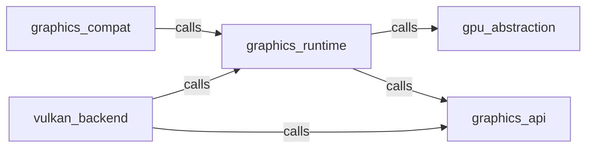

_Generated by CodeAtlas._

## Details

Owns 0 symbols across 0 file(s).

### gpu_abstraction

Owns 0 symbols across 1 file(s).

**Related Classes/Methods:** _None_

### graphics_api

Owns 0 symbols across 1 file(s).

**Related Classes/Methods:** _None_

### graphics_compat

Owns 0 symbols across 1 file(s).

**Related Classes/Methods:** _None_

### graphics_runtime

Owns 0 symbols across 1 file(s).

**Related Classes/Methods:** _None_

### vulkan_backend

Owns 0 symbols across 1 file(s).

**Related Classes/Methods:** _None_
