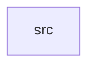

_Generated by CodeAtlas._

## Details

Owns 0 symbols across 1 file(s).

### src

Owns 26 symbols across 1 file(s).

**Related Classes/Methods:** _None_

**Source Files:**

- `crates/graphics_api/src/lib.rs`
  - `crates.graphics_api.src.lib.BufferUsage`
  - `crates.graphics_api.src.lib.CommandStream`
  - `crates.graphics_api.src.lib.CommandStream.push`
  - `crates.graphics_api.src.lib.GraphicsApi`
  - `crates.graphics_api.src.lib.GraphicsDevice`
  - `crates.graphics_api.src.lib.GraphicsDevice.queue`
  - `crates.graphics_api.src.lib.GraphicsOp`
  - `crates.graphics_api.src.lib.ImageUsage`
  - `crates.graphics_api.src.lib.MemoryClass`
  - `crates.graphics_api.src.lib.Pipeline`
  - `crates.graphics_api.src.lib.PixelFormat`
  - `crates.graphics_api.src.lib.QueueHandle`
  - `crates.graphics_api.src.lib.Resource`
  - `crates.graphics_api.src.lib.ResourceKind`
  - `crates.graphics_api.src.lib.ShaderModule`
  - `crates.graphics_api.src.lib.ShaderStage`
  - `crates.graphics_api.src.lib.Timeline`
  - `crates.graphics_api.src.lib.WorkloadClass`
  - `crates.graphics_api.src.lib.default_tier`
  - `crates.graphics_api.src.lib.require_capability`
  - `crates.graphics_api.src.lib.tests.capability_check_accepts_valid_grant`
  - `crates.graphics_api.src.lib.tests.capability_check_rejects_missing_grant`
  - `crates.graphics_api.src.lib.tests.command_stream_records_ops`
  - `crates.graphics_api.src.lib.tests.default_tiers_match_capability_sensitivity`
  - `crates.graphics_api.src.lib.tests.device_finds_queue_by_class`
  - `crates.graphics_api.src.lib.tests.resource_kind_buffer_construction`
