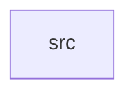

_Generated by CodeAtlas._

## Details

Owns 0 symbols across 1 file(s).

### src

Owns 10 symbols across 1 file(s).

**Related Classes/Methods:** _None_

**Source Files:**

- `crates/graphics_compat/src/lib.rs`
  - `crates.graphics_compat.src.lib.DrmCompatShim`
  - `crates.graphics_compat.src.lib.DrmCompatShim.handle`
  - `crates.graphics_compat.src.lib.DrmCompatShim.new`
  - `crates.graphics_compat.src.lib.DrmRequest`
  - `crates.graphics_compat.src.lib.DrmResponse`
  - `crates.graphics_compat.src.lib.tests.gem_create_and_close_round_trip`
  - `crates.graphics_compat.src.lib.tests.gem_create_fails_for_unknown_device`
  - `crates.graphics_compat.src.lib.tests.mode_get_resources_returns_empty_by_default`
  - `crates.graphics_compat.src.lib.tests.prime_export_returns_handle`
  - `crates.graphics_compat.src.lib.tests.shim_ready`
