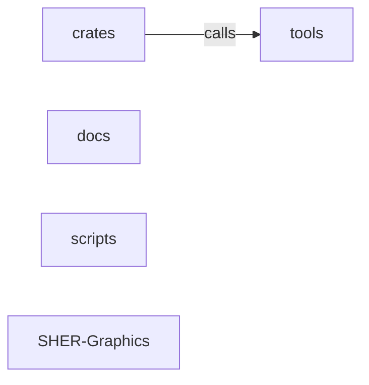

_Generated by CodeAtlas._

## Details

Architecture map of SHER-Graphics.

### crates

Owns 0 symbols across 0 file(s).

**Related Classes/Methods:** _None_

### docs

Owns 0 symbols across 0 file(s).

**Related Classes/Methods:** _None_

### scripts

Owns 0 symbols across 1 file(s).

**Related Classes/Methods:** _None_

### tools

Owns 0 symbols across 0 file(s).

**Related Classes/Methods:** _None_

### SHER-Graphics

Owns 0 symbols across 13 file(s).

**Related Classes/Methods:** _None_
