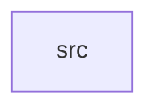

_Generated by CodeAtlas._

## Details

Owns 0 symbols across 1 file(s).

### src

Owns 18 symbols across 1 file(s).

**Related Classes/Methods:** _None_

**Source Files:**

- `crates/vulkan_backend/src/lib.rs`
  - `crates.vulkan_backend.src.lib.AdapterInfo`
  - `crates.vulkan_backend.src.lib.VulkanContext`
  - `crates.vulkan_backend.src.lib.VulkanContext.available`
  - `crates.vulkan_backend.src.lib.VulkanContext.drop`
  - `crates.vulkan_backend.src.lib.VulkanContext.enumerate_adapters`
  - `crates.vulkan_backend.src.lib.VulkanContext.probe`
  - `crates.vulkan_backend.src.lib.VulkanContext.render_clear_inner`
  - `crates.vulkan_backend.src.lib.VulkanContext.render_clear_to_offscreen`
  - `crates.vulkan_backend.src.lib.VulkanError`
  - `crates.vulkan_backend.src.lib.VulkanError.fmt`
  - `crates.vulkan_backend.src.lib.VulkanError.from`
  - `crates.vulkan_backend.src.lib.cleanup_buffer`
  - `crates.vulkan_backend.src.lib.cleanup_image`
  - `crates.vulkan_backend.src.lib.find_memory_type`
  - `crates.vulkan_backend.src.lib.tests.clear_color_render_round_trips_through_real_gpu_memory`
  - `crates.vulkan_backend.src.lib.tests.enumerate_adapters_returns_real_device_data`
  - `crates.vulkan_backend.src.lib.tests.offscreen_render_supports_multiple_sequential_calls`
  - `crates.vulkan_backend.src.lib.tests.probe_reports_availability_without_panicking`
